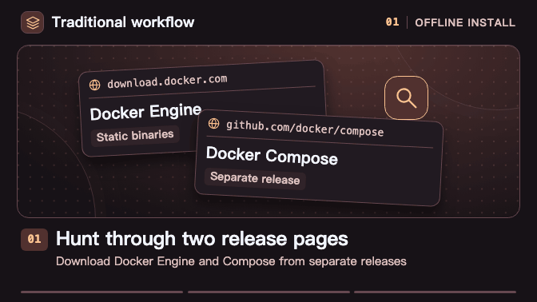
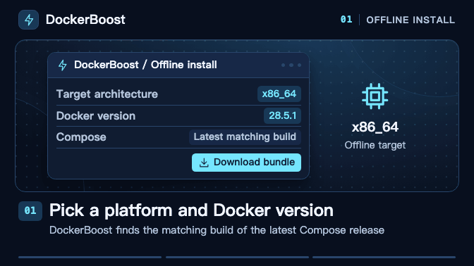
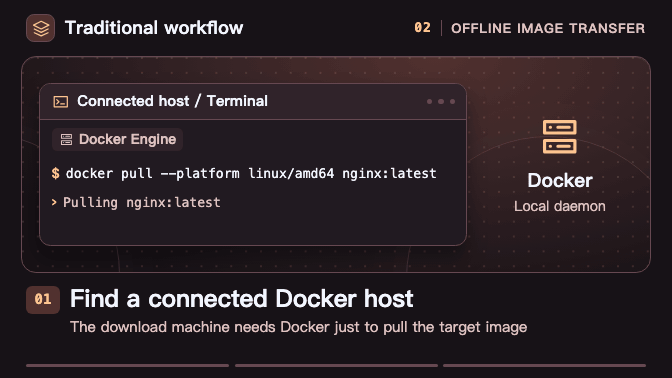
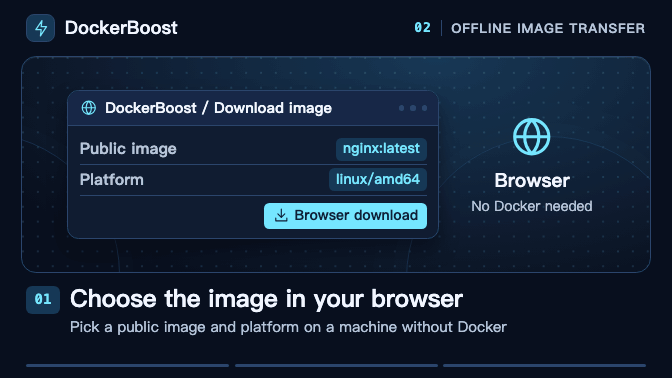
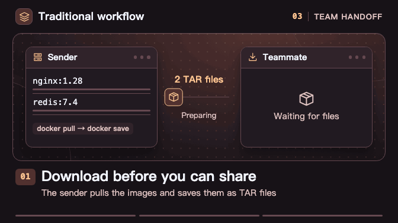
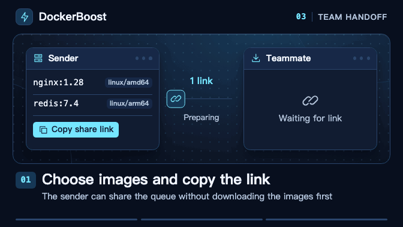
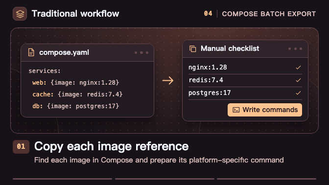
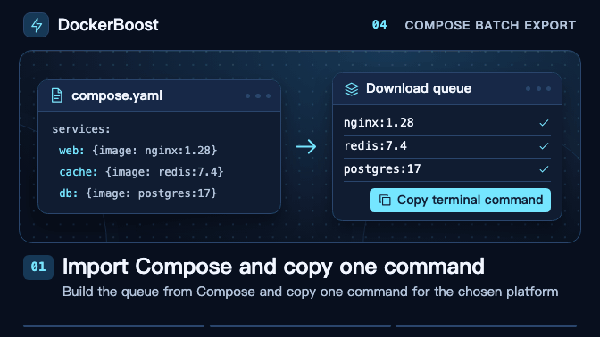

<div align="center">

<a href="https://docker.coolcat.win/"></a>

[简体中文](README.md) · **English**

**Install Docker, generate pull commands, and take images offline.**

[Live demo](https://docker.coolcat.win/) · [Workflow comparisons](#use-cases) · [Local development](#local-development) · [Deploy](#deployment) · [Documentation](#documentation)

</div>

DockerBoost is a Docker toolkit for Cloudflare Workers and EdgeOne Pages. Generate installation and pull commands, configure registry mirrors, and prepare offline archives from one page. The server streams image data while your browser or terminal builds TAR archives locally. The download machine can run without Docker.

## What you can do

| Tab | What it does |
| --- | --- |
| Install | Generate an online install command or download an offline bundle with Docker and Compose |
| Setup | Generate registry mirror settings, backup commands, and recovery commands |
| Pull | Generate pull and tag commands by platform, including for image lists and Compose files |
| Download | Download image TARs in the browser or terminal. Both support batches, and the browser has stop and retry controls |
| Convert | Convert between `docker run` commands and Compose configurations in the browser |
| Manual | Look up Docker and Docker Compose commands, options, and examples |

Pull and Download share single-image selections. Choose a source manually or automatically for individual images. Batch queues choose sources automatically and support both bulk and per-image platform selection. Share individual image settings or a download queue with a link.

## Use cases

[01 Offline install](#01-install-docker-and-compose-offline) · [02 Offline image transfer](#02-take-an-image-offline-from-the-browser) · [03 Queue sharing](#03-share-an-image-download-queue) · [04 Compose batch export](#04-export-a-batch-of-images-from-compose)

Each pair shows the traditional workflow on the left and DockerBoost on the right. Click a clip to see it full size.

### 01. Install Docker and Compose offline

- **Traditional workflow** Download Docker and Compose separately, check the target architecture, copy the files, and configure the systemd service.
- **DockerBoost** Pick an architecture and Docker version. Download one bundle with Docker, Compose, checksums, and an installer. Copy it to the target Linux machine, unpack it, and follow the included instructions.

<p align="center">
  <a href="docs/assets/workflow-demos/offline-docker-install-traditional-en.gif"></a>
  <a href="docs/assets/workflow-demos/offline-docker-install-our-en.gif"></a>
</p>

### 02. Take an image offline from the browser

- **Traditional workflow** Run `docker pull` on a connected Docker host, then use `docker save` to export the TAR.
- **DockerBoost** Select a public image and platform in a connected browser. The browser downloads and verifies the layers, then builds the TAR locally.

<p align="center">
  <a href="docs/assets/workflow-demos/offline-image-transfer-traditional-en.gif"></a>
  <a href="docs/assets/workflow-demos/offline-image-transfer-our-en.gif"></a>
</p>

Copy the TAR to the target machine running Docker and import it with `docker load`.

### 03. Share an image download queue

- **Traditional workflow** The sender pulls the images, exports them as TARs, and uploads them for the teammate to download.
- **DockerBoost** The sender shares a queue link. Opening it restores the image names, tags, and platforms so the teammate can start downloading when needed.

<p align="center">
  <a href="docs/assets/workflow-demos/image-queue-sharing-traditional-en.gif"></a>
  <a href="docs/assets/workflow-demos/image-queue-sharing-our-en.gif"></a>
</p>

### 04. Export a batch of images from Compose

- **Traditional workflow** Copy image references from Compose and repeat `docker pull` and `docker save` on a connected Docker host.
- **DockerBoost** Import Compose, add the images you want, and choose a platform. Run one command on a connected machine to download in parallel and save one TAR per image.

<p align="center">
  <a href="docs/assets/workflow-demos/compose-batch-export-traditional-en.gif"></a>
  <a href="docs/assets/workflow-demos/compose-batch-export-our-en.gif"></a>
</p>

The clips simplify the interface. See the next section for the requirements that apply. [Animation project and export instructions](tools/workflow-demos/README.en.md)

## Requirements and limitations

### Image downloads and batch input

- **Public images** Automatic source selection uses the first successful response. Availability depends on cached images, upstream authentication, rate limits, and network conditions.
- **Browser downloads** Use a browser with OPFS support and enough disk space. Batch exports may prompt you to allow multiple downloads.
- **Terminal downloads** The scripts require `sh`, `curl`, `jq`, `tar`, and other common tools. Offline installation bundles also require `sha256sum`. Scripts remove temporary files on normal exit, failure, or catchable interruption.
- **Compose input** Run `docker compose config` first to expand variables and multiple files. The importer reads images and platforms. Handle `build` in your local Docker workflow.

### Docker installation and configuration

- **Offline installation** Use a fresh Linux installation with systemd and dependencies such as `iptables` and `ip6tables`. DockerBoost selects the latest stable Compose build for the chosen architecture. Follow the bundled `readme.md`. Uninstall applies to installations recorded by the script.
- **Online installation and mirrors** Online installation uses LinuxMirrors scripts. Restart Docker after applying mirror settings. On Docker Desktop, use its settings interface.
- **Site updates** Older pages or copied versioned download commands may expire. Refresh the page and copy the command again.

## Local development

Use **Node.js 22 or later** and **pnpm 12.14.0**. Install dependencies and start Wrangler from the repository root.

```sh
pnpm install --frozen-lockfile
pnpm run dev
```

Open the URL printed in your terminal. Wrangler builds and watches changes automatically. Run the full checks before contributing.

```sh
pnpm run validate
```

See the guide for prerequisites, debugging entry points, and individual checks. [Local development and tools](docs/development.md) · [Contributor instructions](AGENTS.md)

## Deployment

Install dependencies first. Set public page settings and default image sources in `config.js`. Platform settings live in `wrangler.jsonc` and `edgeone.json`.

### Cloudflare Workers

Set the Worker name in `wrangler.jsonc`, then sign in and deploy.

```sh
pnpm exec wrangler login
pnpm run deploy
```

### EdgeOne development and deployment

Sign in, link the project, and deploy.

```sh
pnpm exec edgeone login
pnpm exec edgeone makers link
pnpm run deploy:edgeone
```

The deploy commands build the complete project for both platforms. The EdgeOne script uses `--area overseas` and publishes the static assets and edge functions together.

GitHub Actions validates pull requests and deploys the configured platforms after validation on pushes to `main`. Manual runs let you select a branch and platform and update the corresponding production site. [Authentication, previews, and runtime variables](docs/deployment.md)

## Project structure

| Location | Purpose |
| --- | --- |
| `src/client/` | Page, six tool tabs, and shared styles |
| `src/api/`, `edge-functions/` | Hono APIs, streaming Registry proxy, and platform entry points |
| `src/common/` | Pure logic shared by the client and API, including image reference parsing and archive naming |
| `public/`, `scripts/` | Site assets, build tooling, and architecture checks |
| `tools/workflow-demos/`, `docs/assets/workflow-demos/` | README animation project and exported GIFs |
| `tests/` | API, script, archive, and frontend logic regression tests |
| `docs/` | Development guides, specifications, plans, and historical records |

See the architecture guide for directory responsibilities and dependency directions. [System architecture](docs/architecture.md)

## Documentation

Detailed guides are in Chinese.

- Look up API endpoints and image source configuration. [API reference](docs/api.md)
- Learn how downloads, archives, retries, and queue sharing work. [Download tasks and caching](docs/downloads.md)
- Find other topics, development plans, and historical records. [Full documentation index](docs/README.md)
