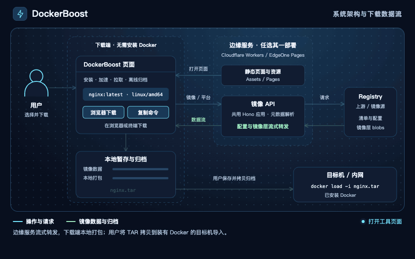
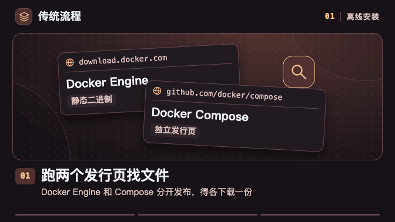
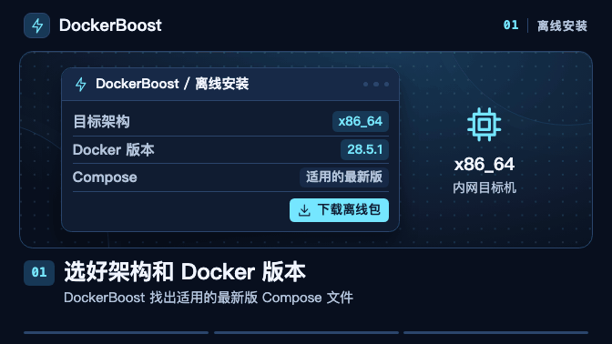
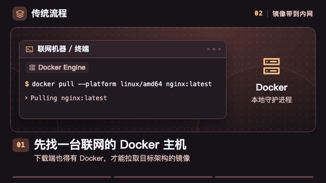
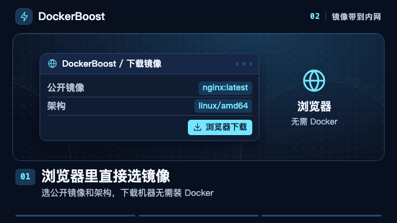
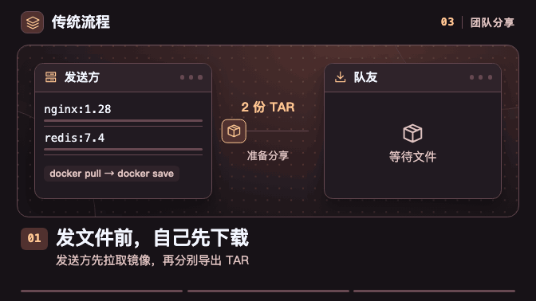
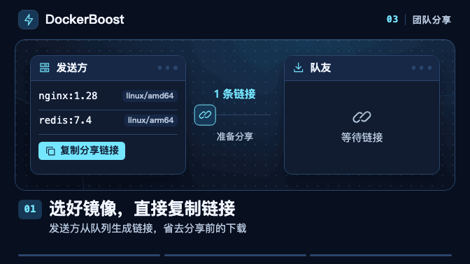
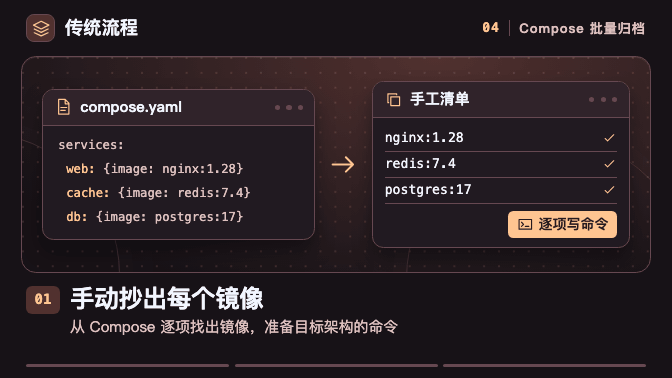
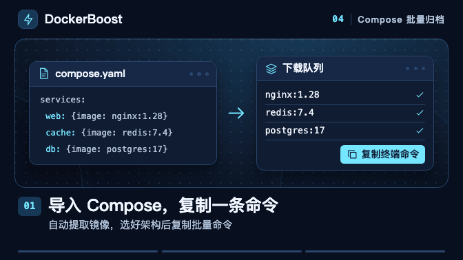

<div align="center">

<a href="https://docker.coolcat.win/"></a>

**简体中文** · [English](README.en.md)

**安装 Docker、生成拉取命令、把镜像带到内网。**

[在线体验](https://docker.coolcat.win/) · [场景对比](#使用场景) · [本地开发](#本地开发) · [部署](#部署) · [文档导航](#文档导航)

</div>

DockerBoost 把 Docker 安装、镜像加速、拉取命令和离线归档集中在一个页面，可部署在 Cloudflare Workers 和 EdgeOne Pages。下载镜像时，服务端流式转发，浏览器或终端在本地组装 TAR。下载端无需安装 Docker。

<p align="center">
  <a href="docs/assets/workflow-demos/project-architecture-our-zh.gif"></a>
</p>

## 你可以用它做什么

| 站内标签 | 用途 |
| --- | --- |
| 安装 | 生成在线安装命令，或下载包含 Docker 和 Compose 的离线包 |
| 配置 | 生成镜像加速配置、备份和恢复命令 |
| 拉取 | 按镜像和架构生成拉取及标签命令，支持批量导入镜像列表或 Compose |
| 下载 | 在浏览器或终端将镜像下载为 TAR，支持批量下载及浏览器内停止、重试 |
| 转换 | 在浏览器内互转 `docker run` 命令和 Compose 配置 |
| 手册 | 查找 Docker 和 Docker Compose 的命令、选项及示例 |

拉取与下载共享单个镜像的选择。单镜像支持自动或手动选源，批量队列自动选源，架构可统一设置或逐项调整。单镜像参数和下载队列都可以通过链接分享。

## 使用场景

[01 离线安装](#01-离线安装-docker-和-compose) · [02 镜像带到内网](#02-从浏览器把镜像带到内网) · [03 分享队列](#03-分享镜像下载队列) · [04 Compose 批量导出](#04-从-compose-批量导出镜像)

每组左侧是传统流程，右侧是 DockerBoost。点击动图可查看大图。

### 01. 离线安装 Docker 和 Compose

- **传统流程** 分别下载 Docker 和 Compose，核对目标架构，复制文件并配置 systemd 服务。
- **DockerBoost** 选好架构和 Docker 版本，下载一份含 Docker、Compose、校验文件和安装脚本的离线包。拷贝到目标 Linux 后解包，按包内说明安装。

<p align="center">
  <a href="docs/assets/workflow-demos/offline-docker-install-traditional-zh.gif"></a>
  <a href="docs/assets/workflow-demos/offline-docker-install-our-zh.gif"></a>
</p>

### 02. 从浏览器把镜像带到内网

- **传统流程** 在联网的 Docker 主机上执行 `docker pull`，再用 `docker save` 导出 TAR。
- **DockerBoost** 在联网浏览器里选择公开镜像和架构，下载并校验镜像层，在本地生成 TAR。

<p align="center">
  <a href="docs/assets/workflow-demos/offline-image-transfer-traditional-zh.gif"></a>
  <a href="docs/assets/workflow-demos/offline-image-transfer-our-zh.gif"></a>
</p>

把 TAR 拷贝到装有 Docker 的目标机器，再执行 `docker load`。

### 03. 分享镜像下载队列

- **传统流程** 发送方拉取镜像、导出 TAR 并上传，队友再下载归档。
- **DockerBoost** 发送方只需分享队列链接。队友打开后恢复镜像名、版本标签和架构，按需开始下载。

<p align="center">
  <a href="docs/assets/workflow-demos/image-queue-sharing-traditional-zh.gif"></a>
  <a href="docs/assets/workflow-demos/image-queue-sharing-our-zh.gif"></a>
</p>

### 04. 从 Compose 批量导出镜像

- **传统流程** 从 Compose 逐项抄出镜像，在联网 Docker 主机上反复执行 `docker pull` 和 `docker save`。
- **DockerBoost** 导入 Compose，加入所需镜像并选好架构，复制一条命令到联网终端并发下载。每个镜像生成一份独立 TAR。

<p align="center">
  <a href="docs/assets/workflow-demos/compose-batch-export-traditional-zh.gif"></a>
  <a href="docs/assets/workflow-demos/compose-batch-export-our-zh.gif"></a>
</p>

动图简化了操作界面，实际运行条件见下节。[动画工程与导出说明](tools/workflow-demos/README.md)

## 使用前须知

### 镜像下载与批量输入

- **公开镜像** 自动选源使用首个成功响应。可用性取决于镜像缓存、上游鉴权、限流和网络条件。
- **浏览器下载** 需要支持 OPFS 的浏览器和足够磁盘空间。批量保存时，浏览器可能要求允许多文件下载。
- **终端下载** 需要 `sh`、`curl`、`jq`、`tar` 等常见工具，下载离线安装包还需 `sha256sum`。脚本在正常退出、失败或可捕获中断时清理暂存文件。
- **Compose 输入** 先用 `docker compose config` 展开变量和多文件配置。导入只提取镜像和平台，`build` 由本地 Docker 工作流处理。

### Docker 安装与配置

- **离线安装** 适用于全新安装的 systemd Linux，目标机需要 `iptables`、`ip6tables` 等系统依赖。DockerBoost 按所选架构匹配适用的最新正式版 Compose，操作步骤见包内 `readme.md`。卸载仅处理脚本有记录的安装。
- **在线安装与镜像加速** 在线安装使用 LinuxMirrors 脚本。应用镜像加速配置后需重启 Docker，Docker Desktop 用户可通过设置界面应用。
- **站点更新** 旧页面或已复制的版本化下载命令可能失效，刷新后重新复制即可。

## 本地开发

使用 **Node.js 22 或更新版本**和 **pnpm 12.14.0**。在仓库根目录执行以下命令，安装依赖并启动 Wrangler。

```sh
pnpm install --frozen-lockfile
pnpm run dev
```

打开终端输出的地址。Wrangler 会自动构建并监听变更。提交前可运行以下完整检查。

```sh
pnpm run validate
```

环境依赖、调试入口和单项检查见[本地开发与工具](docs/development.md)。参与开发前阅读 [AGENTS.md](AGENTS.md)。

## 部署

先安装依赖。页面公开配置和默认镜像源位于 `config.js`，平台配置位于 `wrangler.jsonc` 和 `edgeone.json`。

### Cloudflare Workers

在 `wrangler.jsonc` 设置 Worker 名称，然后登录并部署。

```sh
pnpm exec wrangler login
pnpm run deploy
```

### EdgeOne 开发与部署

登录、关联项目，再执行发布。

```sh
pnpm exec edgeone login
pnpm exec edgeone makers link
pnpm run deploy:edgeone
```

两个平台的部署命令都会构建完整项目。EdgeOne 发布脚本使用 `--area overseas`，同时发布静态资源与边缘函数。

GitHub Actions 会验证 Pull Request，推送 `main` 后验证并发布已配置的平台。手动运行可以选择分支和平台，并更新对应的生产站点。认证、预览和运行时变量见[平台开发与部署](docs/deployment.md)。

## 项目结构

| 位置 | 职责 |
| --- | --- |
| `src/client/` | 页面、六个工具标签与共用样式 |
| `src/api/`、`edge-functions/` | Hono API、Registry 流式透传和平台入口 |
| `src/common/` | 前端和 API 共用的镜像引用解析、归档命名等纯逻辑 |
| `public/`、`scripts/` | 主站静态资源、构建及架构检查 |
| `tools/workflow-demos/`、`docs/assets/workflow-demos/` | README 动画工程及导出的 GIF |
| `tests/` | 接口、脚本、归档和前端逻辑回归测试 |
| `docs/` | 开发指南、专题规范、计划和历史记录 |

目录职责与依赖方向见[系统架构](docs/architecture.md)。

## 文档导航

- 查阅接口与镜像源配置。[接口参考](docs/api.md)
- 了解镜像下载、归档、重试和队列分享。[下载任务与缓存](docs/downloads.md)
- 查找其他专题、开发计划和历史记录。[完整文档索引](docs/README.md)
